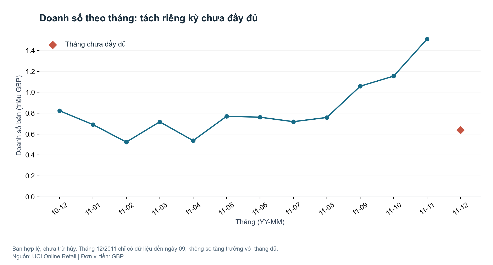
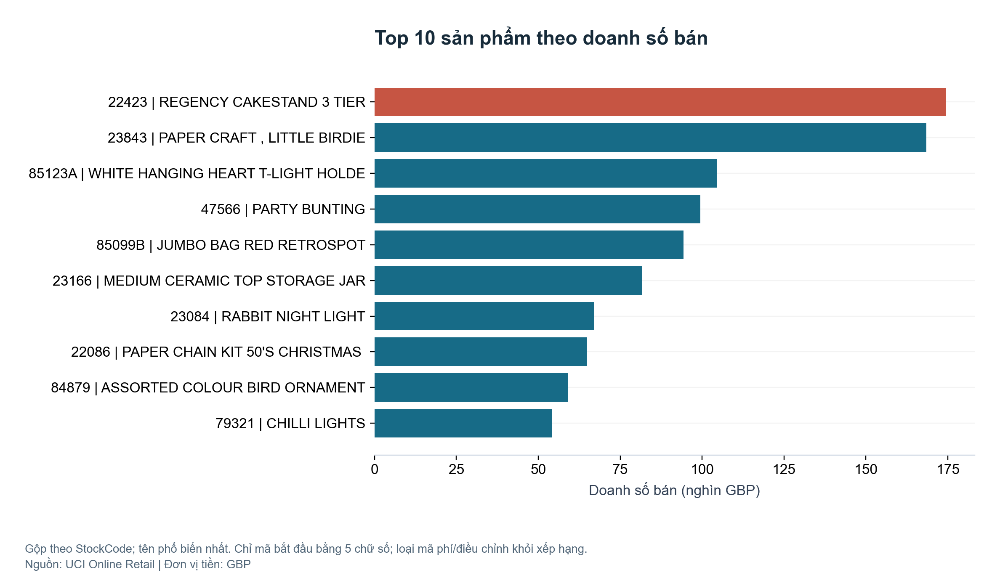
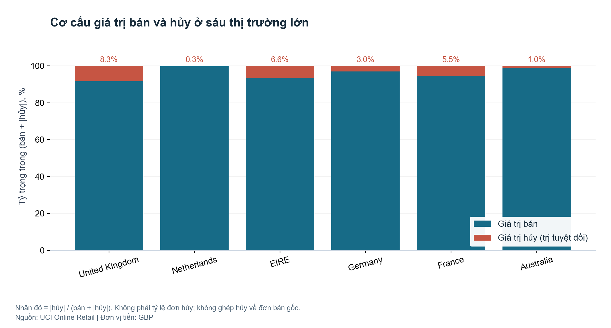
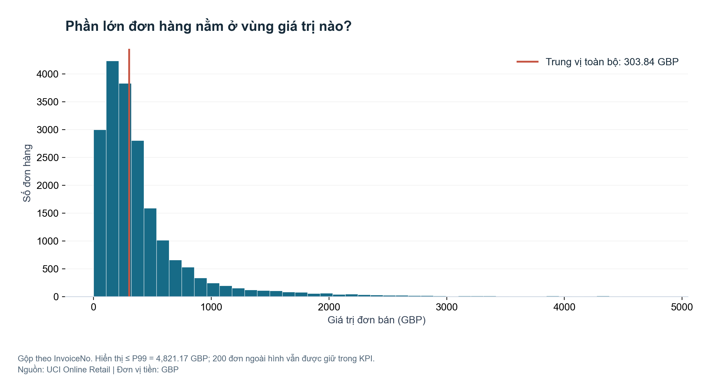
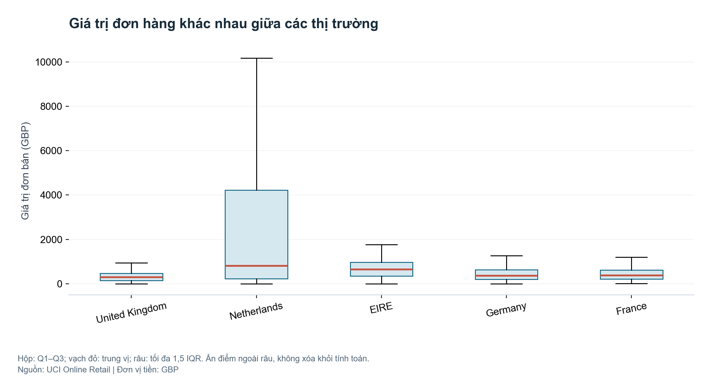
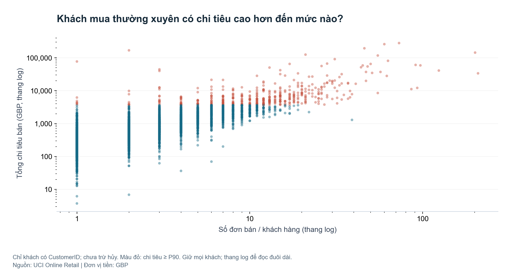

VISUAL ANALYTICS · BÀI TẬP TRÊN LỚP

Doanh thu tập trung ở đâu?

Khách hàng, sản phẩm và giao dịch hủy trong UCI Online Retail

Sinh viên / Nhóm: ........................................
Lớp: ........................................
Giảng viên: ........................................

Ngày hoàn thiện: 23/10/2026 · Công cụ: Python, Pandas, Matplotlib

## Tóm tắt điều hành

Bài phân tích xem xét 541,909 dòng hàng thực tế để xác định nơi tập trung doanh số và những điểm cần kiểm tra về giá trị hủy. Doanh số bán hợp lệ là 10,666,684.54 GBP; United Kingdom đóng góp 84.61%. Trong tập khách được định danh, nhóm xấp xỉ 10% khách chi tiêu cao nhất đóng góp 61.38% doanh số. Giá trị hủy bằng 8.41% doanh số bán; riêng hai chứng từ lớn nhất chiếm 27.39% giá trị hủy. Cần rà soát chứng từ thay vì mặc định coi toàn bộ là hàng trả lại.

Thông điệp: ưu tiên thị trường và khách hàng đóng góp lớn, đồng thời kiểm tra chứng từ hủy và đơn ngoại lệ trước khi ra quyết định. Đây là phân tích lịch sử mô tả, không phải dự báo hay kết luận nhân quả.

Lộ trình đọc: bối cảnh (trang 2) → xử lý dữ liệu (trang 3) → sáu góc nhìn (trang 4–9) → hành động (trang 10).

---

## Bối cảnh · Dữ liệu và câu hỏi kinh doanh

Đối tượng sử dụng: người phụ trách bán hàng và chăm sóc khách hàng của nhà bán lẻ trực tuyến. Câu hỏi trọng tâm: doanh số tập trung ở thị trường/sản phẩm nào, giá trị đơn phân bố ra sao và nhóm khách nào cần ưu tiên?

UCI Online Retail ghi nhận giao dịch của một doanh nghiệp bán lẻ không có cửa hàng tại Anh, chủ yếu bán quà tặng; có nhiều khách bán buôn. Khoảng quan sát thực tế: 2010-12-01 08:26:00 đến 2011-12-09 12:50:00. Mỗi dòng là dòng hàng trong hóa đơn, không phải một đơn độc lập.

| Biến | Ý nghĩa và vai trò |
| --- | --- |
| InvoiceNo / StockCode | Mã hóa đơn / mã sản phẩm; biến định danh. Tiền tố C chỉ hóa đơn hủy. |
| Description / Country | Mô tả sản phẩm / quốc gia khách hàng; biến định tính. |
| Quantity / UnitPrice | Số lượng / đơn giá theo GBP; biến định lượng. |
| InvoiceDate / CustomerID | Thời điểm hóa đơn / mã khách hàng; thời gian và định danh. |

Dữ liệu có 541.909 dòng và 8 cột, vượt yêu cầu đề bài. Trang UCI ghi 6 features vì hai cột mã được phân vai ID; tệp gốc có đủ 8 biến.

## Định nghĩa chỉ số

Giá trị dòng = Quantity × UnitPrice. Doanh số bán = tổng giá trị các dòng bán hợp lệ, chưa trừ hủy. Giá trị hủy = tổng trị tuyệt đối các dòng mã C, số lượng âm và đơn giá dương. Đơn bán = số InvoiceNo khác nhau trong tập bán hợp lệ. Chi tiêu khách = tổng doanh số bán theo CustomerID có dữ liệu.

Nguồn: Chen, D. (2015). Online Retail [Dataset]. UCI Machine Learning Repository. DOI: 10.24432/C5BW33. Giấy phép CC BY 4.0. Trang dữ liệu: https://archive.ics.uci.edu/dataset/352/online-retail. Tệp nguồn, ngày tải và SHA-256 được lưu trong data/raw/source.json.

---

## Tiền xử lý · Minh bạch trước khi diễn giải

| Bước / nhóm | Số dòng |
| --- | --- |
| Dữ liệu thô | 541,909 |
| Giao dịch bán hợp lệ | 530,104 |
| Giao dịch hủy hợp lệ | 9,288 |
| Dòng bất thường / không hợp lệ | 2,517 |
| Bán có mã khách hàng | 397,884 |
| Bán thiếu mã khách hàng | 132,220 |
| Dòng trùng hoàn toàn (sau dòng đầu) | 5,268 |

CustomerID thiếu 135,080 dòng; Description thiếu 1,454 dòng. Không điền mã khách hàng giả. Thiếu mô tả không làm mất giá trị dòng nếu mã và số liệu vẫn hợp lệ. Bảng quality.csv ghi kiểu dữ liệu, tỷ lệ thiếu và số giá trị khác nhau cho mọi cột.

Có 10,624 dòng số lượng âm; trong đó 1,336 dòng không có mã C. Đơn giá bằng 0: 2,515 dòng; âm: 2 dòng. Các dòng không đạt quy tắc được lưu vào other.csv; không chuyển tất cả số lượng âm thành hủy.

Giữ 5,268 dòng trùng hoàn toàn sau lần xuất hiện đầu vì không có mã dòng hàng để xác nhận lỗi. Nếu loại chúng, doanh số giảm 24,573.74 GBP, tương đương 0.23%, và giá trị hủy giảm 2,832.76 GBP. Đây là phân tích độ nhạy, không phải số liệu chính.

Ngoại lệ lớn không bị xóa. Histogram giới hạn hiển thị ở P99; boxplot ẩn điểm ngoài râu; scatter dùng thang log. KPI vẫn tính trên toàn bộ dòng hợp lệ. Tháng 12/2011 chưa đầy đủ được tách khỏi đánh giá đỉnh theo tháng đầy đủ.

Chênh lệch bán trừ |hủy| trong kỳ: 9,769,872.05 GBP. Chỉ số này không phải lợi nhuận và không phải doanh thu thuần đã đối soát vì chưa ghép chứng từ hủy với đơn gốc; có thể có hóa đơn hủy thuộc ngoài kỳ.

---

## 01 · Xu hướng: xác định giai đoạn cần ưu tiên

Line chart nối các tháng đầy đủ để thể hiện biến động theo thời gian. Kỳ chưa đủ được đánh dấu riêng.

Phát hiện — Trong các tháng đầy đủ quan sát được, 2011-11 có doanh số cao nhất: 1,509,496.33 GBP. Tháng đầy đủ cuối cùng có doanh số 1,509,496.33 GBP, thay đổi +30.69% so với tháng đầy đủ trước đó.

Diễn giải — Mức tăng gợi ý cần chuẩn bị năng lực phục vụ cho giai đoạn cuối năm, nhưng một năm dữ liệu chưa đủ chứng minh mùa vụ lặp lại. Chưa có dữ liệu chiến dịch hoặc tồn kho để kết luận nguyên nhân tăng.

Hành động — Ưu tiên kiểm tra kế hoạch hàng hóa và nhân lực trước giai đoạn cao điểm; kiểm chứng bằng dữ liệu nhiều năm. Không diễn giải tháng 12/2011 thấp là suy giảm vì chỉ quan sát đến ngày 09.

---

## 02 · Sản phẩm: chọn nơi ưu tiên nguồn lực

Bar chart ngang giúp so sánh và đọc tên sản phẩm dài; trục giá trị bắt đầu từ 0.

Phát hiện — Sản phẩm dẫn đầu là REGENCY CAKESTAND 3 TIER (mã 22423), đạt 174,484.74 GBP. Top 10 mã sản phẩm chiếm 9.08% tổng doanh số bán hợp lệ.

Diễn giải — Xếp hạng theo mã, chưa trừ hủy. Mã 23843 có dòng bán 168,469.60 GBP và dòng C581484 hủy cùng giá trị; chưa khẳng định ghép đơn chính xác, nhưng đây là tín hiệu cần kiểm tra trước khi xem doanh số gộp là nhu cầu bền vững. Các mã không bắt đầu bằng 5 chữ số, tổng 395,649.93 GBP, vẫn có trong KPI nhưng không vào xếp hạng. Quy tắc nhận diện sản phẩm cần đối chiếu danh mục chính thức.

Hành động — Rà soát khả năng đáp ứng của nhóm sản phẩm dẫn đầu. Chưa quyết định tăng nhập chỉ từ doanh số: cần bổ sung tồn kho, biên lợi nhuận và giá trị hủy theo sản phẩm.

---

## 03 · Thị trường: nhìn đồng thời quy mô và giá trị hủy

Stacked bar 100% so sánh cơ cấu bán và trị tuyệt đối hủy giữa sáu thị trường có doanh số bán lớn nhất.

Phát hiện — United Kingdom đóng góp 84.61% doanh số bán. Tổng giá trị hủy là 896,812.49 GBP, bằng 8.41% doanh số bán. Trong sáu thị trường lớn, United Kingdom có |hủy|/bán cao nhất, 9.03%. Hai chứng từ hủy lớn nhất chiếm 27.39% tổng giá trị hủy (245,653.20 GBP).

Diễn giải — Nhãn đỏ trên hình dùng |hủy|/(bán + |hủy|), khác chỉ số |hủy|/bán trong phần diễn giải. Hai mẫu số được ghi rõ để không nhầm cơ cấu với tỷ lệ hủy trên doanh số. Giao dịch hủy có thể thuộc đơn ngoài kỳ; mã C có cả Manual/AMAZONFEE, vì vậy không coi đây là tỷ lệ khách trả hàng hoặc tỷ lệ đơn bị hủy. Bảng cancellation_invoices.csv và large_cancellation_lines.csv lưu bằng chứng để đối soát.

Hành động — Ưu tiên kiểm tra chứng từ hủy có giá trị lớn ở thị trường đóng góp chính. Muốn tìm nguyên nhân cần ghép chứng từ gốc, lý do hủy và thông tin vận chuyển.

---

## 04 · Phân phối: vì sao số trung bình dễ gây hiểu lầm?

Histogram thể hiện tần suất theo khoảng giá trị đơn. Mỗi InvoiceNo chỉ đóng góp một quan sát.

Phát hiện — Từ 19,960 đơn bán, giá trị trung vị là 303.84 GBP trong khi trung bình là 534.40 GBP. Đơn lớn nhất đạt 168,469.60 GBP; phân vị 99 là 4,821.17 GBP.

Diễn giải — Chênh lệch giữa trung bình và trung vị phản ánh đuôi phải dài: một số đơn lớn kéo trung bình lên. Hình chỉ hiển thị các đơn không vượt P99 để đọc phần tập trung; mọi đơn lớn vẫn nằm trong KPI. Dữ liệu nguồn có khách bán buôn, nhưng chưa thể xác định từng đơn lớn là bán buôn hay lỗi chỉ từ giá trị.

Hành động — Theo dõi đồng thời trung vị, trung bình và đơn giá trị lớn; kiểm tra chứng từ ngoại lệ trước khi dùng chúng để lập mục tiêu giỏ hàng.

---

## 05 · Khác biệt thị trường: một mục tiêu không phù hợp cho tất cả

Boxplot so sánh trung vị và độ phân tán giá trị đơn giữa năm thị trường có doanh số lớn nhất.

Phát hiện — Trong năm thị trường được chọn, trung vị giá trị đơn cao nhất ở Netherlands: 806.88 GBP; thấp nhất ở United Kingdom: 300.50 GBP. Quy mô mẫu từng nước được lưu trong bảng orders.csv.

Diễn giải — Hộp thể hiện Q1–Q3, vạch đỏ là trung vị, râu giới hạn theo 1,5 IQR. Điểm ngoài râu được ẩn để hình dễ đọc nhưng vẫn tham gia tính phân vị và doanh số. Khác biệt có thể liên quan cơ cấu khách hàng hoặc sản phẩm; chưa có kiểm định hay thiết kế nhân quả để khẳng định tác động của quốc gia.

Hành động — Thử thiết lập mục tiêu giá trị đơn theo thị trường và kiểm tra cơ cấu khách hàng trước khi áp dụng ưu đãi chung. Đối chiếu cả quy mô mẫu và số đơn khi so sánh.

---

## 06 · Khách hàng: ưu tiên chăm sóc dựa trên mức đóng góp

Scatter plot thể hiện đồng thời số đơn và tổng chi tiêu. Hai trục log giữ được khách cực lớn mà vẫn đọc được phần còn lại.

Phát hiện — Có 4,338 khách được định danh; doanh số của họ chiếm 83.54% tổng doanh số. Nhóm 434 khách chi tiêu cao nhất (xấp xỉ 10%) đóng góp 61.38% doanh số trong tập khách được định danh. Tương quan Spearman giữa số đơn và chi tiêu là 0.807.

Diễn giải — Tổng chi tiêu được cộng từ đơn mua nên quan hệ với số đơn có thành phần cơ học; tương quan không chứng minh tăng tần suất sẽ gây tăng chi tiêu. Màu đỏ chỉ nhóm chi tiêu từ P90 trở lên; ranh giới có thể bao gồm đồng hạng. Tỷ trọng top 10% trong lời dẫn dùng số khách làm tròn lên và xếp hạng xác định.

Hành động — Ưu tiên chăm sóc khách đóng góp cao và theo dõi mức độ phụ thuộc doanh số vào họ. Bổ sung dữ liệu mới nhất, giao dịch hủy và chi phí phục vụ trước khi xác định giá trị vòng đời hoặc chạy chương trình giữ chân.

---

## Hành động · Từ bằng chứng đến việc cần làm

| Ưu tiên | Đề xuất / Cách kiểm chứng |
| --- | --- |
| 1. Kiểm tra giá trị hủy | Đối soát chứng từ hủy lớn, tách phí/điều chỉnh với hàng trả. Theo dõi |hủy|/bán và số chứng từ đã xác minh. |
| 2. Chăm sóc khách đóng góp cao | Lập danh sách top chi tiêu trong tập có mã; kiểm tra chi tiêu sau hủy và chi phí phục vụ. Theo dõi giữ chân trên dữ liệu cập nhật. |
| 3. Chuẩn bị giai đoạn cao điểm | Rà soát hàng hóa dẫn đầu và năng lực phục vụ. Bổ sung dữ liệu nhiều năm trước khi coi mức tăng cuối năm là mùa vụ. |
| 4. Điều chỉnh theo thị trường | Thử mục tiêu giá trị đơn phù hợp từng nước; đánh giá theo trung vị, quy mô mẫu và cơ cấu khách hàng. |

## Giới hạn và điều kiện áp dụng

Dữ liệu 2010–2011 không phản ánh thị trường hiện tại. Không có giá vốn, ngân sách quảng cáo, tồn kho, lý do hủy hay thông tin giao hàng. Không thể tính lợi nhuận, xác định tác động quảng cáo hoặc kết luận nguyên nhân hủy. Phân tích khách hàng chỉ đại diện cho phần có CustomerID; không ngoại suy tỷ trọng top khách cho phần không định danh.

Số liệu hủy chưa ghép với đơn gốc; dòng trùng được giữ và có phân tích độ nhạy. Đơn có một số dòng không hợp lệ chỉ được tính theo các dòng bán hợp lệ còn lại. Quy tắc nhận diện sản phẩm dựa vào cấu trúc StockCode cần được kiểm chứng với danh mục chính thức.

## Thiết kế và khả năng tái lập

Form follows Function: đường cho xu hướng, thanh cho so sánh, thanh chồng cho cơ cấu, histogram và boxplot cho phân phối, scatter cho tương quan. Data-ink ratio: bỏ hiệu ứng 3D, khung và lưới đậm; dùng xanh làm dữ liệu chính, đỏ nhấn phần cần chú ý. Mọi chỉ số được tạo từ cùng quy trình Python, có bảng tổng hợp và kiểm tra đối soát.
